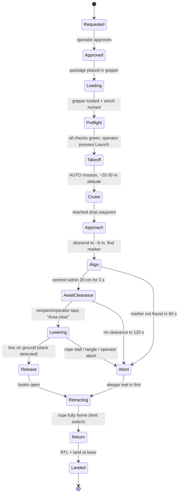

# 1. System Architecture

## 1.1 The one-paragraph version

A clinic worker opens the **app** and requests items. The base-station **operator** approves it,
loads the package into the **gripper**, runs a pre-flight checklist and presses *Launch*. The
**backend server** (a laptop at the base) uploads a GPS mission to the **flight controller**
over the **telemetry radio**. The drone flies there by GPS. At the destination, the onboard
**Raspberry Pi** takes over: it uses the **downward camera** to find a printed **ArUco marker**
on the drop pad and keeps the drone centred above it, while the **rangefinder** measures the
real height above ground. Once the recipient confirms "area clear" in the app, the Pi tells the
**ESP32 payload controller** to lower the rope, open the hooks when the box touches the ground,
and reel the rope back in. Then the drone flies home (RTL) and lands.

## 1.2 Component map

```mermaid
flowchart LR
  subgraph Ground["Ground (base station)"]
    R[Requester phone<br/>web app]
    O[Operator laptop<br/>dashboard]
    S[Backend server<br/>FastAPI + pymavlink<br/>SQLite]
    GR[SiK telemetry radio<br/>USB, ground side]
    RC[RC transmitter<br/>safety pilot]
    R <-- HTTPS / WebSocket --> S
    O <-- HTTPS / WebSocket --> S
    S <-- MAVLink over USB --> GR
  end

  subgraph Drone["Drone"]
    AR[SiK telemetry radio<br/>air side]
    FC[CrossFlight FC<br/>ArduCopter]
    GPS[GPS + compass]
    LID[Rangefinder<br/>TF-Luna]
    RX[RC receiver]
    ESC[4x 40A ESC → 4x motors]
    PI[Raspberry Pi<br/>companion computer]
    CAM[Downward camera]
    ESP[ESP32<br/>payload controller]
    WIN[Winch motor + encoder<br/>+ limit switch]
    GRIP[2-hook servo gripper]
    AR <-- MAVLink UART --> FC
    GPS --> FC
    LID --> FC
    RX --> FC
    FC --> ESC
    FC <-- MAVLink UART --> PI
    CAM --> PI
    PI <-- USB serial JSON --> ESP
    FC -. PWM backup trigger .-> ESP
    ESP --> WIN
    ESP --> GRIP
  end

  GR <-. 433 MHz radio link .-> AR
  RC -. 2.4 GHz RC link .-> RX
```

### Who is responsible for what (the most important design decision)

| Layer | Brain | Responsible for | Why here |
|-------|-------|-----------------|----------|
| Flight | **CrossFlight FC (ArduCopter)** | Stabilising, GPS waypoints, altitude hold, geofence, failsafes (RTL on low battery / lost link) | Proven, real-time, safety-critical. We never replace this, we only command it. |
| Mission & vision | **Raspberry Pi** | Drop-zone sequence, marker detection, precision alignment, telling the winch what to do | Needs a camera + OpenCV; runs **on the drone** so the drop still completes safely if the radio link drops |
| Payload | **ESP32** | Motor speed, encoder counting (rope length), limit switch, gripper servo, winch safety timeouts | Hard real-time I/O. A Linux Pi shouldn't be counting encoder pulses or be the last line of safety for the rope |
| Business logic | **Backend server** | Orders, users, inventory, mission planning, pre-flight checks, telemetry fan-out to apps, logs | Has the database and serves the apps |
| Human | **App + RC safety pilot** | Requests, approvals, "area clear", abort; RC pilot can take manual control at any instant | Humans stay in the loop for every safety-relevant step |

**Rule:** the lower the layer, the more authority. The RC pilot overrides everything; the FC's
failsafes override the Pi; the ESP32's own safety logic (auto-retract, stall stop) overrides
whatever the Pi asks.

## 1.3 Communication links

| Link | Medium | Protocol | Carries | Notes |
|------|--------|----------|---------|-------|
| App ↔ Server | Wi-Fi / hotspot / internet | REST + WebSocket (JSON) | Orders, live telemetry (5 Hz), events, commands | For a remote demo, expose the laptop with Cloudflare Tunnel or ngrok |
| Server ↔ Drone | SiK telemetry radio | MAVLink 2 @ 57600 baud | Telemetry, mission upload, mode changes, payload status | Low bandwidth (~a few kB/s): **no video**. Use 433 MHz in India (915 MHz is not licence-free there) |
| FC ↔ Pi | UART (3.3 V) | MAVLink 2 @ 921600 | Everything the Pi needs + `LANDING_TARGET` for precision | Pi runs `mavlink-router` so several local programs can share the link |
| Pi ↔ ESP32 | USB cable | Newline-delimited JSON | Winch commands and status | USB also powers the ESP32 logic |
| FC → ESP32 | One PWM servo output | PWM pulse width | **Backup** trigger: the RC pilot can lower/retract with a switch | Lets us test the winch in flight before the Pi exists, and it's a manual fallback |
| RC Tx → FC | 2.4 GHz RC | SBUS/PPM | Manual control, mode switch, payload switch | Required for every flight |

Payload status reaches the app like this: ESP32 → Pi → **FC (as MAVLink messages)** → SiK
→ server → WebSocket → app. So the operator sees rope length and gripper state live, with
no extra radio.

## 1.4 Delivery mission flow



**Abort always means: stop lowering → reel the rope in → hold position → operator decides
(retry / RTL / land).** The drone never flies off with the rope hanging out unless the
retract itself has failed (then it climbs to safe height and RTLs, and the operator is alerted).

## 1.5 Failure handling summary

| Failure | Who detects | Response |
|---------|-------------|----------|
| Telemetry link lost | FC (GCS failsafe) + Pi | Pi finishes/aborts the drop safely and retracts; FC RTLs |
| RC link lost | FC (RC failsafe) | RTL |
| Low battery | FC (battery failsafe) | RTL (low) / land (critical); Pi aborts drop and retracts first |
| GPS glitch / EKF bad | FC | Holds / lands per ArduPilot EKF failsafe |
| Marker not found | Pi | Hold, report, operator can drop on GPS only or abort |
| Rope stall / tangle | ESP32 (encoder stopped while motor driven / current spike) | Stop motor, alert; operator chooses retry or emergency release |
| Pi crashes | ESP32 heartbeat watchdog + FC | ESP32 auto-retracts if rope is out; FC continues mission / RTL |
| Leaving the allowed area | FC geofence | RTL |
